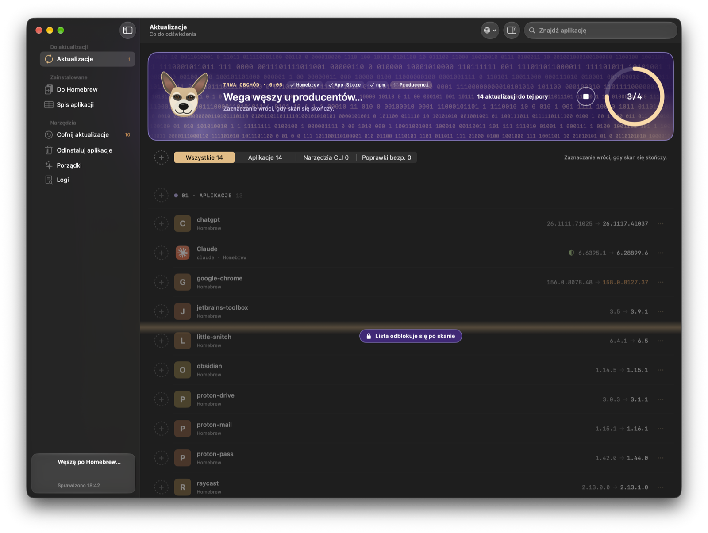
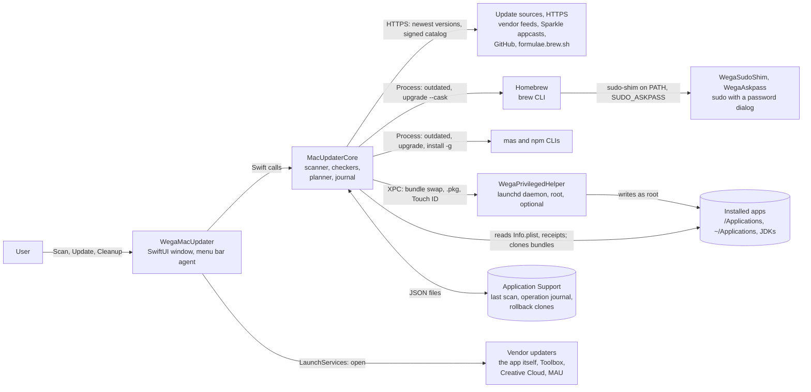
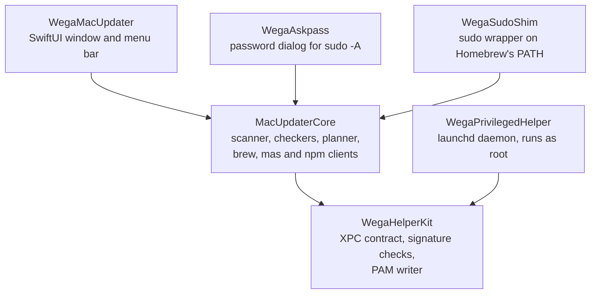
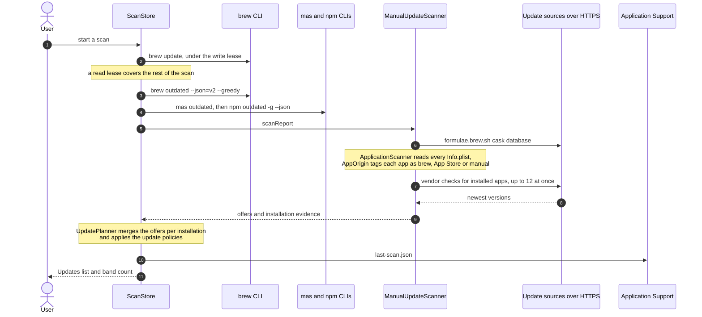
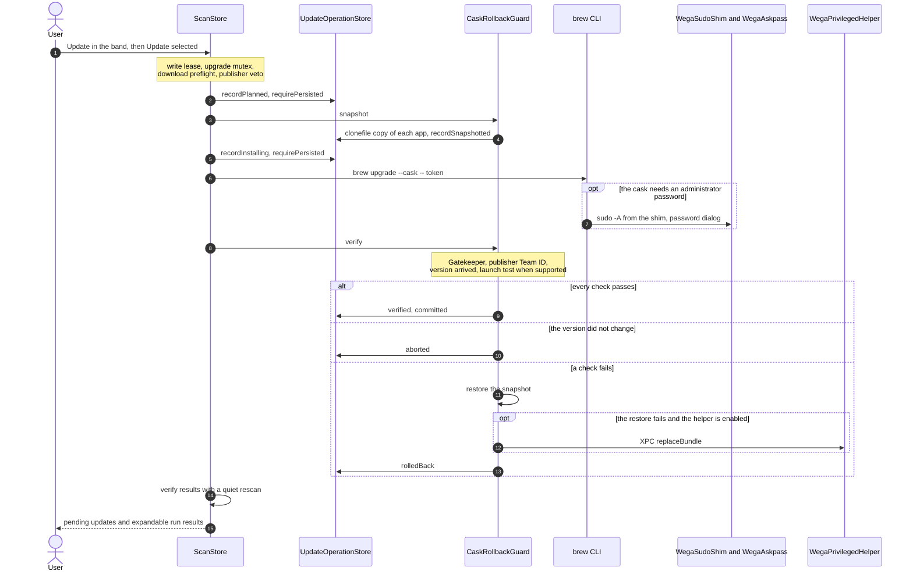
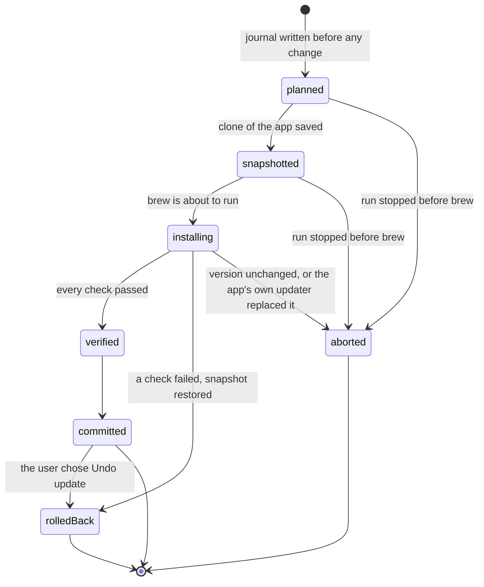
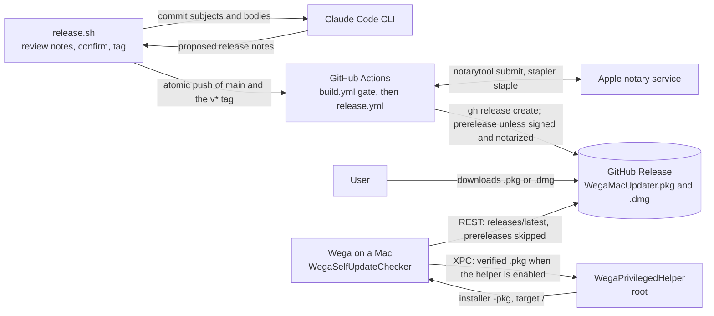

# Wega Mac Updater

**Designed and maintained by [Dominik Sienkiewicz](https://www.linkedin.com/in/dominik-sienkiewicz/), built with AI coding agents:** I set the architecture, write the specifications, define the quality gates enforced in CI and review every change.

Native macOS app that keeps every application on your Mac up to date — Homebrew casks, Mac App Store, JetBrains IDEs, GitHub Releases, and Sparkle apps — from a single window. Daily use never needs a terminal; installing Homebrew itself, and turning Touch ID for `sudo` on or off without the optional Wega helper, are the two things that do.

The Updates screen puts a band above the list — how many updates there are, what is queued, how many of
those an undo covers, and the one button that starts them. The rows stay readable during
scans and updates. After a run, pending updates are ready to act on and the latest result
is available in a compact summary.
Wega's portrait — broad ears with rounded tips, dark brows and muzzle, a white chin — is the app icon and the animated mascot.

*The Updates screen during a scan, in the app's Polish localization.*

## The Vision: one window, zero terminals

Package managers have proliferated — Homebrew casks, formulae, Mac App Store, Sparkle auto-updaters, JetBrains Toolbox, GitHub Releases. Each lives in a different UI or CLI. Wega centralises all of them: one native SwiftUI window that knows where every app came from and how to update it correctly. No `brew upgrade` in muscle memory, no App Store tab left open, no missed JetBrains IDE because Toolbox uses `auto_updates: true` and `brew outdated` never fires.

## Documentation

Wega's docs are split by audience. **Start with the one that matches what you want to do.**

| You want to | Read |
|---|---|
| Keep your Mac up to date | **[User Guide](USER_GUIDE.md)** — installation (the `.pkg` is recommended) → first scan → update → diagnostics |
| Know what the app actually does | [Features](docs/features.md) — every screen and every guard, in the order you meet them |
| Understand the pipeline | [How it works](docs/how-it-works.md) — scan → classify → check → compare → act |
| Read the module layout | [Architecture](docs/architecture.md) — module tree and the sudo/helper boundary |
| Build or test it | [Building and testing](docs/building.md) — requirements, commands, CI gates, versioning |
| Ship a release | [Distribution](docs/distribution.md) — cutting a release and how the app self-updates |
| Contribute code | [CONTRIBUTING.md](CONTRIBUTING.md) — build/test setup, CI gates, the catalog-signature gate |
| Report a vulnerability | [SECURITY.md](SECURITY.md) — the private disclosure channel; please don't use public issues |
| Cut a patch release | `./scripts/release.sh` shows the commits and Claude Code's draft. Review the notes and answer `Y` to publish. See [RELEASING.md](RELEASING.md). |

## Architecture

Wega is one Swift package that builds four executables and two libraries besides its test
targets ([`Package.swift`](Package.swift)). The app does its work in its own process and reaches the
rest of the Mac through package-manager command lines, HTTPS update sources and an optional
root helper over XPC. Everything it remembers stays in local files.

### What it is made of

Read it from the user to the right: every arrow names the interface it crosses and what
travels over it.

The privileged helper is registered only when the user turns it on in Settings. Without it,
Wega still scans and runs Homebrew; the helper adds a root fallback for restoring a bundle,
a headless install of Wega's own `.pkg`, moving a root-owned app to the Trash and the Touch ID
setting for `sudo`. The shim and the password dialog are used only while Touch ID for `sudo`
is off. Logs and the JSONL diagnostic traces live in `~/Library/Logs/WegaMacUpdater/`.

### How the code is split

The arrows are the target dependencies declared in `Package.swift`: the root helper links
only the small WegaHelperKit, never the HTTP clients and parsers in MacUpdaterCore.

## Integrations

Every external service and tool the production code calls. Vendor feeds are asked only when a
matching app is installed. The logos only identify the services.

| Service | Used for | Interface | Status |
|---|---|---|---|
|  Homebrew | Cask and formula versions, upgrades, adoption into Homebrew and cleanup | `brew` CLI: `update`, `outdated --json=v2 --greedy`, `upgrade --cask`; the cask database from `formulae.brew.sh/api/cask.json` | Optional; without Homebrew the cask source is absent |
|  Mac App Store | App Store updates | `mas` CLI: `outdated`, `upgrade`, `list`; `mdls` reads each copy's App Store ID | When `mas` is installed |
|  npm | Outdated global packages and their upgrade | `npm` CLI: `outdated -g --json`, `install -g <pkg>@latest` | When `npm` is found through Homebrew, Volta, fnm, nvm or the login shell |
|  GitHub | Releases of catalog-mapped apps such as Bruno and UTM; Wega's own releases and release notes; the signed app catalog | REST `api.github.com/repos/{repo}/releases`; `app-catalog.json` from `raw.githubusercontent.com`, checked against its Ed25519 signature | On; the catalog refresh runs at every launch; a GitHub token in the Keychain is optional |
|  JetBrains | Latest release of each installed JetBrains IDE; the update opens Toolbox | REST `data.services.jetbrains.com/products/releases` | For installed JetBrains IDEs |
| Sparkle appcasts | Newest version of any app that publishes a feed | HTTPS appcast from the app's `SUFeedURL` or the catalog | For apps with an https feed |
|  Google Chrome | Stable, Beta, Dev and Canary versions | REST `versionhistory.googleapis.com` | When Chrome is installed |
|  Google Drive | Drive for desktop version | Omaha v3 XML `POST tools.google.com/service/update2` | When Drive is installed |
| Antigravity | Version of Google's Antigravity IDE | REST update endpoint on `run.app` | When installed |
|  Mozilla | Firefox and Thunderbird versions per channel | REST `product-details.mozilla.org/1.0/*_versions.json` | When installed |
| Microsoft AutoUpdate | Offers for Word, Excel, PowerPoint, Outlook and OneNote; the update hands off to MAU | `msupdate --list --format plist`, read-only | When MAU is installed |
| Adobe Creative Cloud | Versions of Creative Cloud apps | REST product catalog on `oobesaas.adobe.com`, once per scan | Only when Creative Cloud lists installed products |
| OpenAI ChatGPT and Codex | Desktop app versions | Sparkle appcasts on `persistent.oaistatic.com` and `updates.oaistatic.com`, the latter with a placeholder installation ID | When installed |
|    Postman, Discord, Signal | Versions of desktop apps that ship no Sparkle feed | Squirrel feeds on `dl.pstmn.io` and `discord.com/api/updates`; `latest-mac.yml` on `updates.signal.org` | When installed |
|  Obsidian | Version of the self-updated app package | `desktop-releases.json` on `raw.githubusercontent.com` | When installed |
|  Zed | Stable and Preview versions | REST `cloud.zed.dev/releases` | When installed |
| Parallels | Parallels Desktop version | XML feed on `update.parallels.com` | When installed |
|  Synology | Synology Drive Client build | REST `synology.com/api/releaseNote/findChangeLog` | When installed |
|  Docker Desktop | Confirmed shutdown and restart around a Homebrew replacement | Docker's bundled CLI: `desktop stop`, `desktop start`, `info` | When Docker Desktop is installed; excluded from bulk and background updates |
|  GitHub Actions | CI on pushes and pull requests to `main`; releases on `v*` tags | Workflows in [`.github/workflows/`](.github/workflows/) | On |
|  Apple notary service | Notarizes and staples the `.pkg` and `.dmg` | `xcrun notarytool`, `xcrun stapler` in `release.yml` | When the Developer ID and notary secrets are set; otherwise the release is a prerelease |
| SonarCloud | Static analysis and coverage | `sonarqube-scan-action` in `ci.yml` | When the `SONAR_TOKEN` secret is set |

Every fixed URL comes from [`endpoints.json`](Sources/MacUpdaterCore/Resources/endpoints.json);
Sparkle feeds, release-notes links and the size probe of a cask's download use the URLs the
app or the cask names. A file at `~/Library/Application Support/WegaMacUpdater/endpoints.json`
can override the bundled URLs, but a templated URL must stay on https and on a host the
bundled file already uses, or the bundled value is kept. Nothing is uploaded on its own: crash diagnostics are opt-in and stay local,
**Export diagnostics** saves a ZIP where the user chooses, and a bug report opens a prefilled
e-mail or GitHub issue for the user to send.

## A scan and an update, end to end

### A scan

One window scan, from the button to the list: the package managers are asked one after
another, then the per-app vendor checks run in parallel.

The scan at launch skips `brew update` while Homebrew's catalog is still fresh, and the
menu-bar check never runs it.

### Updating a Homebrew cask

What happens between **Update** and the result for an app installed as a cask: the journal
is written before anything changes, and a failed check puts the previous copy back.

Up to three casks upgrade at once; a cask that may ask for an administrator password, or
whose artifacts are unknown, runs in a serial lane. A cask that installs no app bundle, such
as a `.pkg` cask, gets no snapshot and no checks. If a snapshot cannot be made, no cask in
that run is upgraded and the update is reported as postponed.

### The phases of one update

Each app in a run moves through these phases in its operation's `operation.json`
([`UpdateOperationJournal.swift`](Sources/MacUpdaterCore/UpdateOperationJournal.swift)); only
`committed`, `rolledBack` and `aborted` are final.

A crash leaves an item in an unfinished phase, and the next launch settles it: `planned` and
`snapshotted` become `aborted`, `verified` becomes `committed`, and an `installing` item is
checked on disk. An unchanged version is aborted, a new version gets the same checks again,
and a missing app gets its snapshot back. A failed restore leaves the item in `installing`.
Committed snapshots are kept for seven days, which is how long **Undo update** stays possible.

## How a release reaches a Mac

A maintainer reviews the release notes before publishing the tag. Only a signed and
notarized build becomes a stable release that Wega offers as a self-update.

Without the helper, Wega downloads the verified package and opens it for the user to
finish. The release steps and secrets are in [Distribution](docs/distribution.md) and
[RELEASING.md](RELEASING.md).

## What it updates

Homebrew casks, Mac App Store apps, JetBrains IDEs, GitHub Releases, Sparkle apps and
Microsoft AutoUpdate share one list, with npm globals as a third package manager.
Package-manager actions expose their commands in a dry-run panel; supported cask replacements
can restore the previous bundle when replacement fails. You can add eligible Homebrew repairs
and app takeovers individually to the same queue and review them before starting the run.
Vendor handoffs open the owning updater. Details in
[Features](docs/features.md).

## Installation evidence and repair

Installer-based apps and Java runtimes are associated with Homebrew through exact
installation evidence: package receipts or literal application paths declared by the cask.
Ambiguous claims and duplicate installations do not inherit a package's update result.
When an installed package cask matches by name but its ownership is unverified, Inventory
shows **Homebrew association unconfirmed** with the candidate token. This note does not
mark the copy current or grant it a cask update action or policy alias.
JDKs remain in the scan report even when their source is unknown or Homebrew already
lists their update. These reporting associations do not extend app-bundle rollback to
installer packages or Java runtimes.

Cleanup lists distinct copies of an application by bundle identifier, path, and version.
From there you can review the copies and choose one to uninstall with its shared app data
preserved. Links to an existing copy count as part of that installation.

Cask repair checks version and build changes before recording success. Homebrew and
Discord's own updater can both act on the same bundle. Wega verifies Discord Stable on
disk because an unattended launch can trigger a downgrade. When another app has a
Squirrel/ShipIt update that Wega cannot confirm it withdrew, the launch test leaves the
app running. Details are in [Features](docs/features.md).

## Vendor and App Store update sources

App Store checks identify each installed copy by its exact-path Spotlight App Store ID,
validated against `mas list` and the installed version. Only successful, complete queries
can confirm a current or outdated copy; missing identities and duplicate copies stay unconfirmed.

Vendor feeds run even when Homebrew tracks an app. Comparable offers for the same verified
installation appear once, using the newer version and its update action. Raw source evidence
is retained; incomparable versions and Obsidian's separate package updates remain distinct.
A vendor build of the release a cask names counts as that release, while a cask build the
vendor does not state stays incomparable. The same reconciliation controls background update candidates.
Apps already listed by `brew outdated` skip the redundant cask-version lookup while keeping
their independent vendor checks. Missing versions for other cask candidates remain visible
as incomplete checks.
Google Gemini is matched by its bundle identifier to Homebrew's `google-gemini` cask.

WARP and Logi Options+ updates use the vendor's application instead of bulk or background
Homebrew installation. Inventory also recognizes Bitdefender Antivirus for Mac and shows
its installed product version/build separately from the unverified freshness of the product
and threat signatures. WARP's vendor handoff leaves organizational rollout policy in control.

Vendor-installed Word, Excel, PowerPoint, Outlook and OneNote use a read-only Microsoft
AutoUpdate listing and an explicit MAU handoff. App Store copies retain their App Store route.
Only recognized, newer version offers create update rows; an empty or unknown listing never
certifies a particular copy as current. Wega does not install Office through `msupdate`.

Manually installed Firefox and Thunderbird use Mozilla's channel-specific releases. Wega
reads each bundle's channel metadata and keeps Release, ESR and Beta separate, including
overlapping ESR branches. Unknown channels do not inherit a stable-release result. Beta
copies exposing only a base version without the `bN` sequence remain unconfirmed.
Firefox and Thunderbird update actions open the installed app's own updater.
Bruno and UTM use their official GitHub releases without requiring a Homebrew installation.
Bruno opens its own updater with a release-page fallback; UTM requires a macOS release
asset and opens the official releases list, while App Store copies retain the App Store route. Zed checks Stable and Preview
separately and opens the installed app's updater. Cask channel checks also guard migration candidates
and inherited update policies. Opening an updater alone never confirms
that the installed version changed.

## Diagnostics

If Homebrew refuses to load a package definition while untapping, the brew log offers
trust for that exact cask or formula, with its command and persistent effect shown before
the click. Retrying untap is a separate action. Failed remedies remain available; only
a successful command dismisses its action. Wega never automatically trusts a whole tap
or forces removal to bypass this error. Unused taps are removed through separate actions,
so retrying a failed removal does not include a tap that was already removed.

Update operations keep local JSONL traces with a run identifier, stage events, subprocess
output and exits, HTTP attempts, and observed vendor-check results. **Export diagnostics**
includes these traces and a manifest of retention limits, incomplete runs and recording
failures in the existing redacted ZIP. It saves locally through a file picker; nothing is
uploaded. Traces are bounded to 8 MiB per run and retained for up to 14 days, 50 files or
64 MiB in total. They describe what Wega observed, including an interrupted operation;
they do not establish why a vendor's own updater crashed. See
[Diagnostics & troubleshooting](USER_GUIDE.md#4-diagnostics--troubleshooting).

## Docker Desktop updates

Docker Desktop has a separate supervised update flow. The default action opens its own
updater; Homebrew remains an explicit alternative with confirmation. Docker is excluded
from bulk and background upgrades, including previously saved background consent.
Before a Homebrew replacement or rollback, Wega requires confirmed shutdown through
Docker's bundled CLI. It does not force-kill Docker or reset its settings.

An explicit restart checks the local engine with a bounded wait; installing the package
alone never proves engine readiness. Rollback covers only the application bundle, not
settings, VM disks, images, containers or volumes. Docker is excluded from automatic
launch/quit smoke checks, including aliases and renamed bundles. See
[Docker Desktop](USER_GUIDE.md#docker-desktop) and the focused checks in
[Building and testing](docs/building.md).

## Requirements

macOS 26+, Apple silicon or Intel. Homebrew is optional — without it the cask source is simply
absent and the other sources keep working. Full list in [Building and testing](docs/building.md).

## Testing

Tests cover Core policies and app orchestration. Tap-remedy, foreground-diagnostics and
Docker mutation checks run in sequential XCTest suites, separately from Swift Testing migration checks
that share the update mutex. Source guards also check the protected reinstall call chain,
the smoke-test opt-out before launch, generic restart detection, publisher-veto reporting
before mutation, and token-aware manual rollback before journaling and version pinning.
Signature tests sign a throwaway bundle ad hoc with a borrowed Team ID and check that the
post-upgrade publisher read finds no Team ID in it and that **Trust the New Signature** refuses it;
one test expects at least one of the three Developer ID apps in `/Applications` with the smallest
resource seal to keep its Team ID, and is skipped where none is installed.
The check of Wega's own code is tried on a clone of such an app with one byte flipped in the
slice this Mac does not run, then in a nested executable; both copies must be refused, the
untouched app must pass, and the tests are skipped where no universal app with nested code is installed.
A source test keeps the release gate on the same check: the requirements `scripts/verify-bundle.sh`
uses must equal the ones the app builds, and its codesign options must match the app's validation
flags. `scripts/test-verify-bundle-guard.sh` checks with stubbed tools that the gate refuses and names
a mis-signed app, askpass, sudo shim, `.dmg` or `.pkg` payload.
Standalone-source tests cover channel identity, Mozilla beta ordering, GitHub macOS assets,
unknown/error evidence and updater completion.
Scanner regression tests also cover already-listed casks, independent vendor results and
missing versions for candidates that still require a cask check.
Unit-test settings fixtures keep values in memory and clear them during teardown, avoiding
`wega.tests.*.plist` files in the user's preferences directory. They cover settings logic,
not persistence between processes; see [isolated defaults](CONTRIBUTING.md#isolated-userdefaults).
Commands and quality gates are documented in
[Building and testing](docs/building.md#build-and-test).

## License

[MIT](LICENSE)
